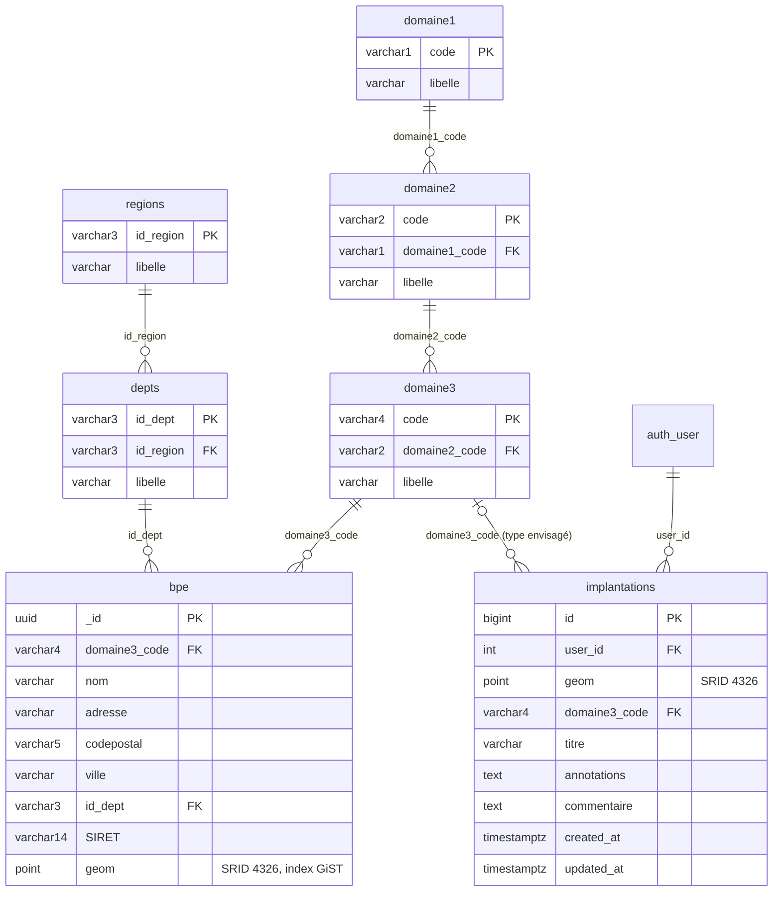

# Prospection commerciale géographique – Groupe 2 (Bourgogne-Franche-Comté)

Application web pour explorer les équipements de la **Base permanente des équipements (BPE 2025)** de l'INSEE sur la région **27 – Bourgogne-Franche-Comté** (~117 000 équipements), et enregistrer ses propres **implantations commerciales potentielles**.

| Couche | Technologie |
|---|---|
| Frontend | React (Vite) + MapLibre GL JS |
| Backend | Python 3.14, Django 6.1, GeoDjango, Django REST Framework, SimpleJWT, drf-spectacular |
| Base de données | PostgreSQL 18 + PostGIS 3.6 (`postgis/postgis:18-3.6`) |

## Installation

Prérequis : Docker et Docker Compose.
> **Mac Apple Silicon (M1, M2, M3…)** : l'image `postgis/postgis` n'existe qu'en version amd64.
> Le `docker-compose.yaml` force donc `platform: linux/amd64` pour la base de données.
> Dans Docker Desktop, cochez **Settings → General → « Use Rosetta for x86_64/amd64 emulation on Apple Silicon »**, puis « Apply & restart ».
```bash
git clone <https://github.com/salima-timzit/GeoProspector.git> && cd <GeoProspector>
cp .env.example .env
docker compose up -d --build
```

- API : http://localhost:8000/api/
- Documentation de l'API (Swagger) : http://localhost:8000/api/docs/
- Admin Django : http://localhost:8000/admin/ (créer un compte : `docker compose exec backend python manage.py createsuperuser`)

Le code du backend n'est **pas copié** dans l'image : `./backend` est monté dans le conteneur, donc toute modification est prise en compte à chaud. L'image ne contient que Python, GDAL/GEOS/PROJ et les dépendances pip.

## Import des données BPE

1. Télécharger le fichier parquet nettoyé dans `data/` (le dossier est ignoré par Git) :
   ```bash
   curl -L -o data/bpe25.parquet.zip https://data.atontour.info/bpe25.parquet.zip
   ```
2. Lancer l'import (le zip est extrait automatiquement) :
   ```bash
   docker compose exec backend python manage.py import_bpe
   # options : --region 27  --file /data/bpe25.parquet  --batch-size 5000
   ```

La commande suit un ETL en 4 étapes :

1. **Extraction** : lecture du parquet avec pandas.
2. **Filtrage** : on garde uniquement la région 27.
3. **Restructuration** : on construit les domaines sur 3 niveaux, puis les régions, les départements et les équipements (clés primaires et étrangères).
4. **Chargement** : `bulk_create` dans l'ordre des dépendances.

La commande peut être relancée sans risque : les tables de référence sont mises à jour et les équipements de la région remplacés. Les implantations des utilisateurs ne sont pas touchées.

## Modèle de données



Les implantations sont stockées dans une table séparée du référentiel BPE.

## API

Documentation complète et interactive : **http://localhost:8000/api/docs/**

| Méthode | URL | Auth | Description |
|---|---|---|---|
| POST | `/api/auth/register/` | – | Inscription `{username, password}` |
| POST | `/api/auth/login/` | – | Retourne `{access, refresh}` (JWT) |
| POST | `/api/auth/refresh/` | – | Nouveau token d'accès |
| GET | `/api/domaines/` | – | Arbre des domaines (3 niveaux) |
| GET | `/api/villes/?search=` | – | Recherche de villes |
| GET | `/api/equipements/?bbox=&domaines=&villes=` | – | Équipements visibles (GeoJSON) |
| GET | `/api/equipements/{id}/` | – | Fiche d'un équipement |
| GET | `/api/equipements/recherche/?q=&ville=` | – | Chercher un équipement par son nom (sans tenir compte des accents, 20 max) |
| GET | `/api/geocodage/?q=` | – | Géolocaliser une adresse postale (API Géoplateforme de l'IGN) ; `dans_zone` et `message` si elle est hors de la région |
| GET / POST | `/api/implantations/` | JWT | Mes implantations |
| GET / PATCH / DELETE | `/api/implantations/{id}/` | JWT | Voir / modifier / supprimer une implantation |

En-tête d'authentification : `Authorization: Bearer <access>`.

#### Détail des routes carte (publiques)

- **`GET /api/domaines/`** : `[{code, libelle, enfants: [{code, libelle, enfants: [{code, libelle}]}]}]`.
- **`GET /api/villes/?search=dij`** : `[{nom, codepostal, id_dept}]`, triées par nom. La recherche est une recherche « contient », sans tenir compte des majuscules, et renvoie au plus 20 résultats. Sans `search`, toutes les villes sont renvoyées.
- **`GET /api/equipements/`** : renvoie une `FeatureCollection` GeoJSON. Chaque Feature contient un `Point [lon, lat]` et les propriétés `{id, nom, ville, domaine1_code, domaine3_code, domaine3_libelle}`.
  - `bbox=minLon,minLat,maxLon,maxLat` (WGS84, **longitude d'abord**). Ce paramètre est **obligatoire**, sauf si `villes` est fourni.
  - `domaines=A,B2,B207` : codes de n'importe quel niveau, séparés par des virgules (1 caractère = niveau 1, 2 = niveau 2, 4 = niveau 3).
  - `villes=Dijon,Beaune` : noms exacts, tels que renvoyés par `/api/villes/`.
  - Les filtres se combinent : ET entre paramètres, OU entre les valeurs d'un même paramètre. Les équipements sans coordonnées sont exclus.
  - Un paramètre invalide (bbox mal formée ou inversée, code de domaine qui ne fait ni 1, ni 2, ni 4 caractères, etc.) renvoie `400 {"detail": "..."}`.
- **`GET /api/equipements/{uuid}/`** : renvoie `{id, nom, adresse, codepostal, ville, siret, dept: {id_dept, libelle}, domaine1|2|3: {code, libelle}, lon, lat}`, ou `404` si l'équipement n'existe pas.

Les routes carte ignorent l'en-tête `Authorization` : un token expiré ne provoque donc pas d'erreur 401.

#### Détail des implantations (JWT obligatoire)

- Corps pour `POST` / `PATCH` : `{lon, lat, domaine3_code, titre, annotations, commentaire}`.
  - `POST` : `lon`, `lat` et `titre` sont obligatoires ; `domaine3_code` peut valoir `null`.
  - `PATCH` : n'importe quel sous-ensemble des champs.
- Réponses :
  - un élément : `Feature` GeoJSON avec les propriétés `{id, titre, domaine3_code, domaine3_libelle, annotations, commentaire, created_at, updated_at}` ;
  - la liste : `FeatureCollection`, du plus récent au plus ancien.
- Codes de retour : `201` à la création, `204` à la suppression, `400` si la validation échoue, `401` sans token.
- Un utilisateur ne voit que ses propres points : ceux d'un autre utilisateur renvoient `404`.

#### Tests

```bash
docker compose exec backend python manage.py test
```

### Chargement optimisé de la carte

- Le front découpe la carte en carrés de 0,1° × 0,1°.
- Il garde en mémoire les carrés déjà chargés et ne demande que les nouveaux quand on se déplace.
- Le cache est vidé quand les filtres changent.
- En dessous du zoom 11, rien n'est chargé.
- Côté serveur, le filtre `bbox` utilise l'index spatial GiST de `bpe.geom`.

## Structure du dépôt

```
docker-compose.yaml
.env.example
data/                 # parquet (non versionné)
backend/
  Dockerfile
  requirements.txt
  config/             # settings, urls (auth JWT + Swagger)
  bpe/                # référentiel BPE + commande import_bpe
  implantations/      # points des utilisateurs
  accounts/           # inscription
frontend/             # React + MapLibre
```

## Post-mortem

Voir [POSTMORTEM.md](POSTMORTEM.md).
